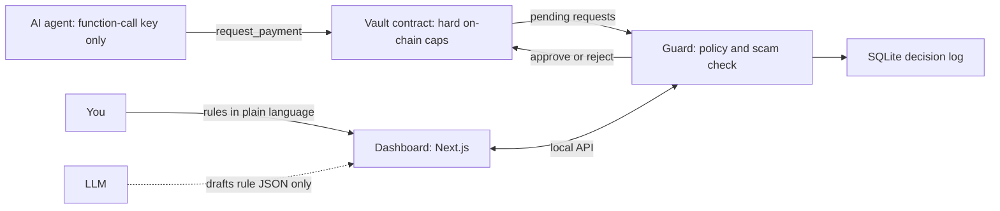

# AgentGuard

**Let an AI agent spend crypto on NEAR without giving it a key that can move your money.**

Track: AI Security & Defense (`security`) at NEAR HACKATHON. Network: NEAR **testnet**. License: MIT.

- Hosted recorded demo (real testnet decisions, read-only): https://agentguard-bice-delta.vercel.app
- Vault contract on testnet: [`vault.jibsonfta.testnet`](https://testnet.nearblocks.io/address/vault.jibsonfta.testnet)

## The problem

To let an AI agent pay for things, teams usually hand it a wallet key. If the agent is tricked (prompt injection, a lookalike address, a bug), it can spend everything. Rate limits in the agent's own code do not help, because the agent controls that code.

## What AgentGuard does

The agent never holds a key that can send money. It can only **ask**. A separate Guard decides, and the vault enforces its own limits on-chain even if the Guard is wrong or compromised.

1. **Sandboxed wallet.** The agent is a NEAR sub-account whose only key is a function-call access key limited to `request_payment` on the vault (0.25 NEAR gas allowance, no deposit). A function-call key cannot transfer NEAR.
2. **Policy in plain language.** You write rules in any language ("max 2 NEAR per payment, 5 a day, ask me above 1.5 NEAR"). An LLM drafts a strict JSON policy. The draft is validated by code, summarized by code, and only goes live when you confirm. **The LLM never decides allow or deny.**
3. **Deterministic checker.** Plain code applies the policy: per-payment limit, daily limit, trusted list, blocklist, approval threshold, risk score. Invalid requests, a missing policy and an unavailable scam check all fail safe (block or ask a human, never pay).
4. **Pre-transaction scam check.** Heuristics on the destination: account does not exist on chain, lookalike of a trusted account (edit distance), known-bad list, phishing-style keywords. Produces a 0-100 risk score with reasons.
5. **Decision flow.** Each request ends as allow (the Guard approves, the vault pays), block (the Guard rejects) or ask (waits in the approvals queue for a human). Every decision is stored with its reasons.
6. **Dashboard** (Next.js + TypeScript): live checkpoint log, approvals queue, rules editor, and a meter showing your daily rule next to the vault's on-chain cap.

## How NEAR is used

| NEAR feature | Role |
| --- | --- |
| Sub-accounts | `agent.<owner>`, `guardian.<owner>`, `vault.<owner>` |
| Function-call access key | The agent's only key: `request_payment` on the vault, nothing else |
| Own smart contract (Rust, `near-sdk` 5) | Holds funds, enforces hard per-payment and daily caps, pays only after the guardian approves |
| Keyless account | The vault has **no access keys**: nobody can sign as the vault or upgrade it; it deploys and initialises in one atomic transaction |

## Architecture



<details>
<summary>Same diagram as text</summary>

```
 AI agent (function-call key only)
        | request_payment (can only ask)
        v
 Vault contract (hard on-chain caps, no keys) <----------------+
        | pending requests                                       | approve / reject
        v                                                        | (guardian key)
 Guard: policy checker + scam check ---------------------------+
        | decision + reasons
        v
 SQLite decision log  <---- local API (127.0.0.1) ----> Dashboard (Next.js) <--- You: rules in plain language
                                                              ^
                                                              | drafts rule JSON only
                                                             LLM
```

</details>

| Actor | Key it holds | Can | Cannot |
| --- | --- | --- | --- |
| Agent | function-call key (`request_payment` on the vault) | ask to pay | send NEAR, approve its own request, call other contracts |
| Vault | none | hold funds, enforce caps, pay after approval | be drained except through its own methods |
| Guardian (the Guard service) | full-access key of `guardian.<owner>` | approve or reject, within the on-chain caps | exceed the on-chain caps |
| Owner (you) | owner key | change caps, rotate guardian, withdraw | |

## Who uses this, and how

AgentGuard is **self-hosted**: you run the Guard and the dashboard on your own machine, and your keys never leave it. There is no hosted multi-user service, no sign-up and no wallet connection in the dashboard yet. The hosted site is a read-only replay of a real run.

To protect your own agent:

1. Deploy a sandbox with the steps in section C below (it creates the vault, the guardian and the agent accounts).
2. Give your agent two things: the vault address (`vault.<owner>.testnet`) and the agent key file (`.keys/agent.<owner>.testnet.json`). That key can only call `request_payment` on the vault.
3. Your agent calls `request_payment(to, amount, memo)` instead of sending money itself. `scripts/agent-demo.mjs` is a working example.
4. You set the rules and approve big payments in the dashboard.

## Try it

You need Node.js 22.13 or newer (the Guard uses the built-in `node:sqlite`).

### A. No setup: open the hosted recorded demo

https://agentguard-bice-delta.vercel.app shows a recorded run of the real testnet Guard (decisions, reasons, one request waiting for approval). It is read-only and says so on the page.

### B. Replay the recorded run locally (no keys, no network needed)

```sh
git clone https://github.com/Ibrahimjibril/agentguard
cd agentguard/web
npm install
NEXT_PUBLIC_DEMO_SNAPSHOT=/demo-snapshot.json npm run dev
```

Open http://localhost:3000. You should see a "Recorded demo" banner, one request "Waiting for you" (1.7 NEAR), and a log of paid and blocked payments with reasons.

### C. Live run on testnet (about 5 minutes)

```sh
git clone https://github.com/Ibrahimjibril/agentguard
cd agentguard
npm install
cp .env.example .env                       # optional: add an LLM key (only needed to draft rules from text)

node scripts/create-account.mjs YOURNAME.testnet   # funded by the testnet faucet; key saved in .keys/
node scripts/deploy.mjs YOURNAME.testnet           # creates vault, guardian and agent accounts
```

You should see three `OK` lines (guardian, agent, vault) and a `get_config` line with the on-chain caps (3 NEAR per payment, 6 NEAR per day). The prebuilt contract is `contract/prebuilt/agentguard_vault.wasm`; CI also builds it from `contract/` (see the `contract` workflow).

```sh
node scripts/guard.ts policy policy.demo.json      # activates: 2 NEAR per payment, 5 NEAR per day, ask above 1.5 NEAR
npm run serve                                      # Guard + local API on http://localhost:8787
```

In a second terminal:

```sh
cd web && npm install && npm run dev               # dashboard on http://localhost:3000
```

In a third terminal run the demo agent. It holds only the function-call key and tries four payments:

```sh
node scripts/agent-demo.mjs
```

Within about 5 seconds the dashboard shows:

| Payment the agent tries | What you should see |
| --- | --- |
| 0.5 NEAR to the owner | **Paid** (within the rules) |
| 2.5 NEAR to the owner | **Blocked** (over the 2 NEAR per-payment limit) |
| 1 NEAR to a lookalike of the owner's address | **Blocked** (risk 100: "Looks like trusted account ...") |
| 1.7 NEAR to the owner | **Waiting for you** (above the 1.5 NEAR approval threshold) |

Click **Approve and pay** on the waiting request: it becomes **Paid**. Click any row to see the reasons and the address-check details.

Prove the sandbox on-chain (reads the stored keys from the chain and attempts forbidden actions):

```sh
node scripts/prove-sandbox.mjs
node scripts/prove-keys.mjs
```

`prove-keys.mjs` prints the access keys stored on-chain: the vault has none, the agent has exactly one function-call key limited to `request_payment`.

### Tests

```sh
npm test      # 65 unit tests: policy engine, rule compiler, scam check, Guard, API, LLM client
```

The contract's 5 unit tests run in CI (`.github/workflows/contract.yml`).

## What is real and what is limited

- **Testnet only.** Nothing here has been deployed to mainnet or audited.
- **The scam check is heuristic.** It checks existence on chain, lookalikes of trusted accounts, a small known-bad list (`data/known-bad.json`, sample entries) and phishing-style keywords. It does **not** yet use account age or transaction history.
- **One guardian.** The Guard holds a single full-access key for `guardian.<owner>` on the machine it runs on. The on-chain caps bound the damage if that key is lost; there is no multisig or TEE yet.
- **`Paid` is written when `approve` runs.** The vault marks the request paid and counts it against the daily cap in the same call that starts the transfer. If the transfer then fails (for example the destination does not exist), the funds return to the vault but the status stays `Paid`. The Guard blocks non-existent named accounts by default, which avoids the common cause.
- **The dashboard has no login.** The Guard API binds to `127.0.0.1`, checks the `Host` header and only accepts browser requests from `localhost` origins, so other websites cannot call it. Do not expose it to a network.
- **The hosted demo cannot change anything.** It replays `web/public/demo-snapshot.json`, exported from a real run with `scripts/export-snapshot.ts`.
- **LLM.** Rule drafting works with any OpenAI-compatible endpoint or Anthropic (see `.env.example`). The default is Google Gemini's free tier. Only the rule text you type is sent. A policy with no limits needs an explicit confirmation before it can go live.

## Repository layout

```
contract/            Rust vault contract (near-sdk 5), unit tests, prebuilt wasm
src/policy/          policy schema + deterministic checker, LLM rule compiler
src/guard/           Guard core, scam heuristics, SQLite store, chain adapter
src/server/          local API for the dashboard
src/llm/             small LLM client with retry and model fallback
scripts/             deploy, demo agent, Guard CLI and server, proof scripts, snapshot export
web/                 Next.js dashboard
brand/               logo files
```

## Libraries, templates and AI assistance

Libraries: [`@fastnear/api`](https://js.fastnear.com) (NEAR RPC and transactions), `near-sdk` 5 and `cargo-near` (contract), Next.js 16, React 19, TypeScript, Node's built-in `node:sqlite` and `node:test`. Fonts: Fraunces and Instrument Sans (Google Fonts). No templates or boilerplate were used.

AI assistance: most of the code, tests and documentation were written with **Claude (Anthropic)** acting as an AI coding assistant, directed, run, tested and deployed by the developer. The rule drafting feature calls an LLM at run time (Gemini by default).

Timeline: the repository was created on 2026-10-30; all code in it was written for this hackathon.

## License

MIT. See [LICENSE](LICENSE).
