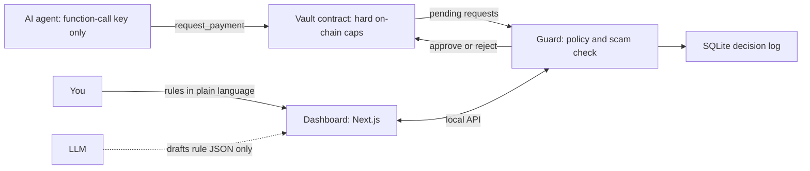

# AgentGuard

**Let an AI agent spend crypto on NEAR without giving it a key that can move your money.**

> Your agent can ask. The gate decides.

Track: **AI Security & Defense** (`security`) · NEAR HACKATHON · Network: NEAR **testnet** · License: MIT

| | |
|---|---|
| Live demo (try it, no install) | https://agentguard-bice-delta.vercel.app |
| Vault contract (testnet) | [`vault.jibsonfta.testnet`](https://testnet.nearblocks.io/address/vault.jibsonfta.testnet) |
| Demo video (X post) | https://x.com/Jibsonfta/status/2118582872256721080 |

---

## For judges: verify it in 2 minutes

No install, no wallet, no keys. Everything below works on the live demo.

1. **Open the live demo** (link above) and tap **Try it live**. You play the AI agent: ask for a payment and watch the Guard decide, with reasons and a 0-100 risk score. Tap the presets to see attacks stopped or held for a human: **Over the limit**, **Lookalike address** (`jibsonfat.testnet` vs the owner `jibsonfta.testnet`), **Phishing name**, and **Needs approval**. Change the three rule boxes and ask again to see the policy drive the decision.
2. **Tap "Verify on-chain".** It reads the real access keys of `vault.jibsonfta.testnet` and `agent.jibsonfta.testnet` from NEAR testnet right now. The vault has **none**. The agent has exactly **one** function-call key, limited to `request_payment`, and a function-call key cannot transfer NEAR. You can cross-check on [NearBlocks](https://testnet.nearblocks.io/address/vault.jibsonfta.testnet).
3. **Scroll the recorded log** on the same page: real decisions from a live testnet run (paid, blocked, and one request waiting for human approval). Click any row for the reasons. Tap **Approve and pay** on the waiting request to see the flow (simulated in your browser, nothing is sent).
4. **Run the full system yourself (optional, about 5 minutes):** see [Run it yourself](#run-it-yourself).

---

## What is inside (and what is real)

The live demo page shows only the dashboard and a checker. The full system is more than that:

| Part | Where | Status |
|---|---|---|
| Vault smart contract (Rust, near-sdk 5), deployed keyless on NEAR testnet | contract/ | Real, on-chain: vault.jibsonfta.testnet |
| Guard service: policy engine, scam check, guardian signer | src/policy, src/guard, src/server | Real, self-hosted |
| Agent client (holds only a function-call key) | src/agent | Real |
| Setup wizard (creates owner, vault, guardian and agent accounts) | src/setup | Real, self-hosted |
| LLM rule drafting (validated before use) | src/policy/compile.ts | Real, needs an LLM key |
| Dashboard | web/ | Real; the hosted copy shows a recorded run plus a live checker |

---

## The problem

To let an AI agent pay for things, teams usually hand it a wallet key. If the agent is tricked (prompt injection, a lookalike address, a bug), it can spend everything. Rate limits inside the agent's own code do not help, because the agent controls that code.

## The solution

The agent never holds a key that can send money. It can only **ask**. A separate Guard decides, and the vault enforces its own limits on-chain even if the Guard is wrong or compromised.

Three independent layers must all agree before money moves:

1. **Your rules**: per-payment limit, daily limit, trusted list, blocklist, approval threshold.
2. **A scam check** on the destination, with a 0-100 risk score and reasons.
3. **The vault's own on-chain caps**, which hold even if layers 1 and 2 fail.

### How it works

1. **Sandboxed wallet.** The agent is a NEAR sub-account whose only key is a function-call access key limited to `request_payment` on the vault (0.25 NEAR gas allowance, no deposit).
2. **Policy in plain language.** You write rules in any language ("max 2 NEAR per payment, 5 a day, ask me above 1.5 NEAR"). An LLM drafts a strict JSON policy. Code validates it, code summarizes it, and it only goes live when you confirm. **The LLM never decides allow or deny.**
3. **Deterministic checker.** Plain code applies the policy. Invalid requests, a missing policy and an unavailable scam check all **fail safe**: block, or ask a human, never pay.
4. **Pre-transaction scam check.** Heuristics on the destination: account does not exist on chain, lookalike of a trusted account (edit distance), known-bad list, phishing-style keywords.
5. **Decision flow.** Every request ends as **allow** (the Guard approves, the vault pays), **block** (the Guard rejects) or **ask** (waits in the approvals queue for a human). Every decision is stored with its reasons.
6. **Dashboard** (Next.js + TypeScript): live checkpoint log, approvals queue, rules editor, and a meter showing your daily rule next to the vault's on-chain cap.

## Architecture



| Actor | Key it holds | Can | Cannot |
|---|---|---|---|
| Agent | function-call key (`request_payment` on the vault) | ask to pay | send NEAR, approve its own request, call other contracts |
| Vault | none | hold funds, enforce caps, pay after approval | be drained except through its own methods |
| Guardian (the Guard service) | full-access key of `guardian.<owner>` | approve or reject, within the on-chain caps | exceed the on-chain caps |
| Owner (you) | owner key | change caps, rotate guardian, withdraw | |

## How NEAR is used

| NEAR feature | Role |
|---|---|
| Sub-accounts | `agent.<owner>`, `guardian.<owner>`, `vault.<owner>` |
| Function-call access key | The agent's only key: `request_payment` on the vault, nothing else |
| Own smart contract (Rust, `near-sdk` 5) | Holds funds, enforces hard per-payment and daily caps, pays only after the guardian approves |
| Keyless account | The vault has **no access keys**: nobody can sign as the vault or upgrade it. It deploys and initialises in one atomic transaction |

## The hosted playground

The "Try the gate" card on the live demo is a real, read-only run of the Guard's decision logic:

- `POST /api/check` runs the **same** `policy.ts` (rule checker) and `scam.ts` (scam heuristics) as the real Guard. Copies live in `web/lib/core/`.
- The scam check asks NEAR testnet RPC whether the destination account exists, so "does not exist on chain" is a live fact, not a canned answer.
- **Nothing is signed and no money moves.** The server holds no keys. It has a basic best-effort rate limit (about 20 checks per minute per IP).
- Rules are set per request in the page. "Spent today" is a counter inside your browser session for the test.
- The trusted account for the lookalike check is the demo owner `jibsonfta.testnet`.
- `GET /api/verify-keys` reads the vault and agent access keys from the chain.

## Who uses this, and how

AgentGuard is **self-hosted**: you run the Guard and the dashboard on your own machine, and your keys never leave it. There is no hosted multi-user service and no sign-up.

1. Start the Guard and the dashboard. On first run the dashboard shows **Create your sandbox**: pick a name and it creates your testnet owner account plus the vault, guardian and agent accounts.
2. The dashboard shows a **Connect your agent** card. Your agent gets the vault address and a key that can only call `request_payment`. It never gets a wallet key.
3. Your agent calls `pay({ to, amountNear, memo })` (see `src/agent/client.ts`, which also exports a ready-made tool description for LLM agents) instead of sending money itself, then waits for the decision.
4. You set the rules and approve big payments in the dashboard.

---

## Run it yourself

> **Judges: you do not need to run anything.** The [live demo](https://agentguard-bice-delta.vercel.app) works in your browser. The `localhost` addresses below only work on your own computer, after you start the server yourself.

Requires **Node.js 22.13+** (the Guard uses the built-in `node:sqlite`).

### Option A: replay the recorded run locally (no keys, no network)

```bash
git clone https://github.com/Ibrahimjibril/agentguard
cd agentguard/web
npm install
NEXT_PUBLIC_DEMO_SNAPSHOT=/demo-snapshot.json npm run dev
```

Open `http://localhost:3000` on your own computer. You should see the "Recorded log, live checker" banner, one request "Waiting for you" (1.7 NEAR), and a log of paid and blocked payments with reasons.

### Option B: live run on testnet (about 5 minutes)

```bash
git clone https://github.com/Ibrahimjibril/agentguard
cd agentguard
npm install
cp .env.example .env     # optional: add an LLM key (only needed to draft rules from text)
npm run serve            # the Guard and its local API on http://localhost:8787
```

In a second terminal:

```bash
cd web && npm install && npm run dev      # dashboard on http://localhost:3000
```

Open `http://localhost:3000` on your own computer, pick a name, press **Create account**, then **Create the sandbox**. The testnet faucet pays for everything (about two minutes).

**Set the rules.** Type, for example, "No more than 2 NEAR per payment and 5 NEAR a day. Ask me above 1.5 NEAR.", press **Draft rules** (needs an LLM key), check the summary, then **Make these rules live**. Without an LLM key, use the ready-made rules:

```bash
node scripts/guard.ts policy policy.demo.json    # 2 NEAR per payment, 5 NEAR per day, ask above 1.5 NEAR
```

**Run the demo agent** in a third terminal. It holds only the function-call key and tries four payments:

```bash
node scripts/agent-demo.mjs
```

Within about 5 seconds the dashboard shows:

| Payment the agent tries | What you should see |
|---|---|
| 0.5 NEAR to the owner | **Paid** (within the rules) |
| 2.5 NEAR to the owner | **Blocked** (over the 2 NEAR per-payment limit) |
| 1 NEAR to a lookalike of the owner's address | **Blocked** (risk 100: "Looks like trusted account ...") |
| 1.7 NEAR to the owner | **Waiting for you** (above the 1.5 NEAR approval threshold) |

Click **Approve and pay** on the waiting request and it becomes **Paid**.

Ask for a payment the way your own agent would:

```bash
node scripts/agent-pay.mjs shop.testnet 0.5 "invoice 42"
```

**Prove the sandbox on-chain** (reads the keys from the chain and attempts forbidden actions):

```bash
node scripts/prove-sandbox.mjs
node scripts/prove-keys.mjs
```

`prove-keys.mjs` prints the access keys stored on-chain: the vault has none, the agent has exactly one function-call key limited to `request_payment`.

Prefer the terminal to the wizard? `node scripts/create-account.mjs YOURNAME.testnet` and `node scripts/deploy.mjs YOURNAME.testnet` do the same two steps. To start from a clean folder, run `GUARD_DATA_DIR=$HOME/demo-run npm run serve`.

### Tests

```bash
npm test      # 90 unit tests: policy engine, rule compiler, scam check, Guard, API, setup wizard, agent client, LLM client
```

The contract's 5 unit tests run in CI (`.github/workflows/contract.yml`).

---

## What is real and what is limited

- **Testnet only.** Nothing has been deployed to mainnet or audited.
- **The hosted checkpoint log is a replay.** It shows `web/public/demo-snapshot.json`, exported from a real testnet run with `scripts/export-snapshot.ts`.
- **The hosted playground is a simulation.** It uses the real checker and live testnet reads, but it does not call the vault, sign anything or pay anyone. Approve and Decline on the hosted page are simulated in your browser only; real approval and payment need the self-hosted Guard (see Run it yourself).
- **The scam check is heuristic.** It checks existence on chain, lookalikes of trusted accounts, a small known-bad list (`data/known-bad.json`, sample entries) and phishing-style keywords. It does not yet use account age or transaction history.
- **One guardian.** The Guard holds a single full-access key for `guardian.<owner>` on the machine it runs on. The on-chain caps bound the damage if that key is lost. There is no multisig or TEE yet.
- **`Paid` is written when `approve` runs.** The vault marks the request paid and counts it against the daily cap in the same call that starts the transfer. If the transfer then fails (for example the destination does not exist), the funds return to the vault but the status stays `Paid`. The Guard blocks non-existent named accounts by default, which avoids the common cause.
- **The owner key is a local testnet key file** created in `.keys/` (never committed). There is no wallet connection yet. Do not reuse this approach for real funds.
- **The dashboard has no login.** The Guard API binds to `127.0.0.1`, checks the `Host` header and only accepts browser requests from `localhost` origins, so other websites cannot call it. Do not expose it to a network.
- **LLM.** Rule drafting works with any OpenAI-compatible endpoint or Anthropic (see `.env.example`). The default is Google Gemini's free tier. Only the rule text you type is sent. A policy with no limits needs an explicit confirmation before it can go live.

## Roadmap

- Wallet connection instead of a local owner key
- Multisig or TEE guardian
- Scam check using account age and transaction history
- Mainnet deployment after an audit

## Repository layout

```
contract/            Rust vault contract (near-sdk 5), unit tests, prebuilt wasm
src/policy/          policy schema + deterministic checker, LLM rule compiler
src/guard/           Guard core, scam heuristics, SQLite store, chain adapter
src/server/          local API for the dashboard (including the sandbox setup routes)
src/setup/           the "create your sandbox" flow (owner account, vault, guardian, agent)
src/agent/           pay() client and tool description for your own AI agent
src/llm/             small LLM client with retry and model fallback
scripts/             deploy, demo agent, Guard CLI and server, proof scripts, snapshot export
web/                 Next.js dashboard, plus the hosted playground (app/api, lib/core)
brand/               logo files
docs/                the author's testnet deployment (public data only)
```

## Libraries, templates and AI assistance

Libraries: [`@fastnear/api`](https://js.fastnear.com) (NEAR RPC and transactions), `near-sdk` 5 and `cargo-near` (contract), Next.js 16, React 19, TypeScript, Node's built-in `node:sqlite` and `node:test`. Fonts: Fraunces and Instrument Sans (Google Fonts). No templates or boilerplate were used.

AI assistance: most of the code, tests and documentation were written with **Claude (Anthropic)** as an AI coding assistant, directed, run, tested and deployed by the developer. The rule drafting feature calls an LLM at run time (Gemini by default).

Timeline: the repository was created on 2026-10-30; all code in it was written for this hackathon.

## License

MIT. See [LICENSE](LICENSE).
